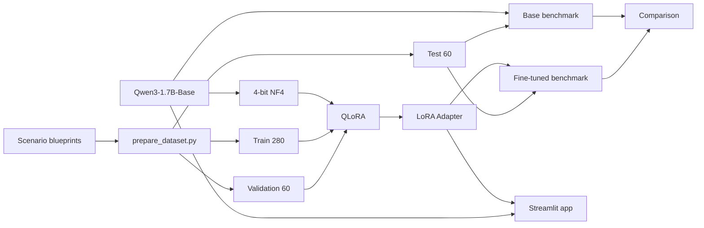

# Big Data Architecture Copilot

> CheckPoint 2/3 — Inteligência Artificial — FIAP 4ESPV-2026  
> Professor: Francisco Elanio Bezerra  
> Entrega: 15/10/2026

LLM local especializada em diagnosticar problemas de arquitetura de dados e recomendar padrões, tecnologias e trade-offs. O projeto está preparado para demonstrar **Supervised Fine-Tuning real com QLoRA**, execução em GPU CUDA, comparação Base vs Fine-tuned e uma interface Streamlit sem API comercial. O status abaixo separa claramente o que já foi validado do que ainda precisa ser executado na GPU da equipe.

---


## Verificação rápida sem GPU (interface e código)

Para demonstrar a estrutura da aplicação **antes de executar o treinamento**, há um modo ilustrativo explícito, baseado em regras e nos blueprints do dataset. **Ele não é uma LLM nem substitui o fine-tuning CUDA exigido na atividade.**

No terminal, apenas com Python:

```powershell
python src/qa_static.py
python src/validate_dataset.py
python src/offline_demo.py
```

Para abrir a interface Streamlit sem instalar as bibliotecas pesadas da LLM:

```powershell
python -m pip install -r requirements-ui.txt
python -m streamlit run app/app.py
```

Sem adapter, a interface anuncia claramente **demonstração baseada em regras**. Após a execução real de `scripts/run_pipeline.ps1` em CUDA, o mesmo frontend carrega o adapter salvo e executa inferência de LLM local. A documentação do método e dos resultados pendentes permanece separada em `RELATORIO_ACADEMICO.md` e `FINAL_REPORT.md`.

## 1. Problema

Modelos gerais conhecem conceitos como Kafka, CDC, OLTP/OLAP, data lakes e processamento distribuído, mas não foram especializados para diagnosticar cenários de arquitetura seguindo um formato técnico consistente.

Exemplo de entrada:

> Temos vários serviços produzindo eventos e vários consumidores. Cada integração é feita ponto a ponto e adicionar um novo consumidor exige alterar vários sistemas.

Saída esperada:

- gargalo;
- causa raiz;
- padrão recomendado;
- solução;
- justificativa técnica;
- tecnologias possíveis;
- vantagens;
- limitações/trade-offs.

---

## 2. Hipótese

**Um fine-tuning supervisionado especializado pode aumentar a consistência e a qualidade do diagnóstico arquitetural quando comparado ao mesmo modelo Base.**

A hipótese será testada em um benchmark fixo não utilizado no treinamento, após executar os experimentos em GPU.

---

## 3. Status real do repositório

| Item | Estado |
|---|---|
| Arquitetura | Implementada |
| Dataset | Implementado: 400 exemplos |
| Split | 280 train / 60 validation / 60 test |
| GPU check | Implementado |
| Stack QLoRA/NF4 | Versões fixadas e smoke test implementado |
| QLoRA training | Implementado |
| 3 experimentos | Configurados |
| Base vs Fine-tuned evaluation | Implementada |
| Avaliação humana cega | Implementada |
| Frontend Streamlit | Implementado |
| Training loss real | **Pendente de execução em GPU** |
| Validation loss real | **Pendente de execução em GPU** |
| Duração/VRAM real | **Pendente de execução em GPU** |
| Benchmark real | **Pendente de adapter treinado** |
| Screenshots CUDA | **Pendentes de execução na máquina** |
| Screenshot do frontend | **Pendente de demo real com adapter** |
| GitHub | **Publicado em [MachadONLY/big-data-architecture-copilotcp2](https://github.com/MachadONLY/big-data-architecture-copilotcp2)** |

Nenhum resultado de treinamento foi inventado.

---

## 4. Modelo escolhido

### Principal

`Qwen/Qwen3-1.7B-Base`

Motivos:

- 1.7B parâmetros;
- 28 layers;
- 32.768 tokens de contexto;
- licença Apache 2.0;
- tamanho compatível com fine-tuning local via QLoRA em GPUs de consumidor, sujeito à VRAM real;
- modelo Base permite observar melhor o comportamento adquirido por SFT.

Model card oficial:

https://huggingface.co/Qwen/Qwen3-1.7B-Base

### Fallback

`Qwen/Qwen3-0.6B-Base`

O fallback só deve ser usado se a GPU real não suportar o 1.7B de forma prática. A troca precisa ser registrada nos configs/resultados.

---

## 5. Arquitetura



Mais detalhes: [`docs/architecture.md`](docs/architecture.md) e [`docs/model_selection.md`](docs/model_selection.md)

---

## 6. Dataset

O projeto contém 400 cenários distribuídos igualmente em 20 categorias:

1. Kafka / event streaming
2. batch vs streaming
3. OLTP vs OLAP
4. filas tradicionais vs logs distribuídos
5. integrações N×M
6. CDC
7. consumer lag
8. particionamento
9. escalabilidade
10. retenção
11. replay
12. schemas
13. data lake
14. data warehouse
15. lakehouse
16. ETL vs ELT
17. disponibilidade
18. replicação
19. processamento distribuído
20. consistência e trade-offs

Split:

| Split | Exemplos | Por categoria |
|---|---:|---:|
| Train | 280 | 14 |
| Validation | 60 | 3 |
| Test | 60 | 3 |
| **Total** | **400** | **20** |

O test set nunca é carregado por `train.py`.

O dataset é sintético, versionado e regenerável a partir de:

`data/raw/scenario_blueprints.json`

Regenerar:

```powershell
python src/prepare_dataset.py
```

Detalhes: [`docs/dataset.md`](docs/dataset.md)

---

## 7. Fine-tuning

Método:

**SFT + QLoRA**

Stack:

- PyTorch
- Hugging Face Transformers
- TRL
- PEFT
- Datasets
- bitsandbytes

Configuração de quantização:

- 4-bit;
- NF4;
- double quantization;
- BF16 quando suportado, senão FP16.

LoRA:

- `target_modules="all-linear"`;
- pesos base congelados;
- apenas adapters treináveis.

O `SFTTrainer` recebe dataset prompt-completion com:

`completion_only_loss=True`

Logo, a loss é calculada sobre a resposta esperada.

---

## 8. Experimentos controlados

| Parâmetro | Experiment 01 | Experiment 02 | Experiment 03 |
|---|---:|---:|---:|
| Learning rate | 2e-4 | 2e-4 | 1e-4 |
| Epochs | 2 | 2 | 2 |
| LoRA rank | 8 | 16 | 16 |
| LoRA alpha | 16 | 32 | 32 |
| Dropout | 0.05 | 0.05 | 0.05 |
| Per-device batch | 1 | 1 | 1 |
| Gradient accumulation | 8 | 8 | 8 |
| Effective batch | 8 | 8 | 8 |
| Max length | 1024 | 1024 | 1024 |
| Seed | 42 | 42 | 42 |

### Comparação 01 → 02

Altera a capacidade do adapter.

### Comparação 02 → 03

Altera learning rate.

Assim não estamos mudando todos os parâmetros ao mesmo tempo.

Configs:

```text
configs/experiment_01.yaml
configs/experiment_02.yaml
configs/experiment_03.yaml
```

---

## 9. GPU

Todos os experimentos oficiais são obrigatoriamente CUDA.

`train.py` aborta caso:

```python
torch.cuda.is_available() == False
```

Primeiro comando:

```powershell
nvidia-smi
```

Checagem completa:

```powershell
python src/gpu_check.py --require-cuda --output assets/screenshots/gpu_environment.json
```

Mais detalhes: [`docs/gpu.md`](docs/gpu.md)

---

## 10. Instalação no Windows / VSCode

### 10.1 Verificar GPU antes de instalar

```powershell
nvidia-smi
```

Não altere CUDA antes de conhecer GPU e driver.

### 10.2 Criar ambiente

```powershell
python -m venv .venv
.\.venv\Scripts\Activate.ps1
python -m pip install --upgrade pip
```

### 10.3 Instalar PyTorch CUDA

Use o seletor oficial para a GPU/driver presentes na máquina:

https://pytorch.org/get-started/locally/

Não existe um comando CUDA hardcoded neste projeto para evitar instalar a build errada.

### 10.4 Confirmar PyTorch CUDA

```powershell
python -c "import torch; print(torch.__version__); print(torch.version.cuda); print(torch.cuda.is_available()); print(torch.cuda.get_device_name(0) if torch.cuda.is_available() else 'NO CUDA')"
```

O resultado precisa mostrar `True`.

### 10.5 Dependências restantes

```powershell
python -m pip install -r requirements.txt
python -m pip install -r requirements-dev.txt
```

### 10.6 GPU check

```powershell
python src/gpu_check.py --require-cuda
python src/verify_stack.py --require-cuda
```

### 10.7 Testes do repositório

```powershell
python -m pytest -q
```

---

## 11. Treinamento

Rodar individualmente:

```powershell
python src/train.py --config configs/experiment_01.yaml
```

```powershell
python src/train.py --config configs/experiment_02.yaml
```

```powershell
python src/train.py --config configs/experiment_03.yaml
```

Ou os três:

```powershell
.\scripts\run_experiments.ps1
```

Durante o treino, abra outro terminal:

```powershell
nvidia-smi -l 2
```

Tire o screenshot exigido enquanto `python.exe` realmente usa VRAM.

### Fallback por VRAM

Se o 1.7B realmente não couber:

```powershell
python src/train.py `
  --config configs/experiment_01.yaml `
  --model-override Qwen/Qwen3-0.6B-Base
```

Se usar fallback, os três experimentos devem usar o mesmo modelo para manter comparabilidade.

---

## 12. Resultados de treinamento

Após cada execução real:

`experiments/results.csv`

recebe automaticamente:

- modelo;
- learning rate;
- epochs;
- batch;
- gradient accumulation;
- rank;
- alpha;
- dropout;
- max length;
- precision;
- GPU;
- VRAM;
- trainable params;
- training loss;
- validation loss;
- duração;
- peak allocated VRAM;
- adapter path.

Também são salvos `environment.json`, `metrics.json`, `training.log`,
`config_used.yaml` e os hashes SHA-256 dos dados de treino/validação.

---

## 13. Avaliação Base vs Fine-tuned

Depois de escolher um adapter:

```powershell
python src/evaluate.py `
  --adapter experiments/experiment_02/adapter
```

Troque o caminho pelo experimento que realmente quiser avaliar.

Saídas:

```text
experiments/evaluation/<timestamp>/
  summary.json
  comparison.csv
  base_predictions.jsonl
  fine_tuned_predictions.jsonl
  worsened_cases.csv
  blind_review.csv
  blind_key_DO_NOT_SHARE_WITH_REVIEWER.csv
```

### Métricas automáticas

- bottleneck term hit;
- architectural pattern term hit;
- required concept coverage;
- format compliance;
- forbidden claim hit;
- ROUGE-L;
- heuristic auto score.

### Avaliação humana

Rubrica 0–4:

- gargalo;
- solução;
- justificativa;
- relevância;
- ausência de alucinação;
- completude;
- clareza.

Detalhes: [`docs/evaluation.md`](docs/evaluation.md)

---

## 14. Frontend

Rodar:

```powershell
streamlit run app/app.py
```

A interface mostra:

- Big Data Architecture Copilot;
- `Running locally`;
- modelo;
- adapter;
- GPU;
- precisão;
- tempo de inferência;
- resposta estruturada.

O frontend não possui código de integração com OpenAI, Claude ou Gemini.

---

## 15. Estrutura

```text
big-data-architecture-copilot/
├── README.md
├── requirements.txt
├── requirements-dev.txt
├── .gitignore
├── LICENSE
├── pyproject.toml
├── configs/
│   ├── experiment_01.yaml
│   ├── experiment_02.yaml
│   └── experiment_03.yaml
├── data/
│   ├── raw/
│   │   └── scenario_blueprints.json
│   ├── processed/
│   │   ├── train.jsonl
│   │   ├── validation.jsonl
│   │   ├── test.jsonl
│   │   ├── dataset_qa.json
│   │   └── manual_review_checklist.csv
│   └── benchmark/
├── src/
│   ├── common.py
│   ├── prompts.py
│   ├── prepare_dataset.py
│   ├── gpu_check.py
│   ├── train.py
│   ├── inference.py
│   ├── evaluate.py
│   └── score_manual_review.py
├── experiments/
│   ├── experiment_01/
│   ├── experiment_02/
│   ├── experiment_03/
│   └── results.csv
├── app/
│   ├── app.py
│   └── .streamlit/config.toml
├── docs/
│   ├── architecture.md
│   ├── dataset.md
│   ├── training.md
│   ├── evaluation.md
│   ├── gpu.md
│   ├── presentation.md
│   ├── references.md
│   └── submission_checklist.md
├── scripts/
│   ├── setup_windows.ps1
│   ├── verify_environment.ps1
│   ├── run_experiments.ps1
│   ├── run_evaluation.ps1
│   └── run_app.ps1
├── tests/
├── models/
│   └── README.md
└── assets/
    ├── charts/
    └── screenshots/
```

---

## 16. Evidências exigidas

| Requisito | Evidência |
|---|---|
| Escolher LLM | model card + justificativa |
| Problema específico | Big Data Architecture Copilot |
| Parâmetros diferentes | configs + `results.csv` |
| Avaliação | `summary.json` + blind review |
| GPU | `gpu_check.py` + `nvidia-smi` |
| Stack compatível | `verify_stack.py` + NF4 real em CUDA |
| Frontend | Streamlit local |
| Print GPU VSCode | `assets/screenshots/gpu_training_vscode.png` |
| Print do frontend | `assets/screenshots/frontend_demo.png` |
| GitHub | commit atual enviado ao `origin`, com working tree limpa |
| Treino real | adapter + loss + logs |
| Base vs Fine-tuned | `comparison.csv` |
| Failure cases | `worsened_cases.csv` |

Checklist: [`docs/submission_checklist.md`](docs/submission_checklist.md)

---

## 17. Limitações

- dataset é sintético e deve ser revisado tecnicamente pelo grupo;
- métricas por keywords são heurísticas;
- ROUGE-L não mede verdade factual;
- resultados dependem da GPU e da versão de software realmente usada;
- um modelo 1.7B não substitui um arquiteto experiente;
- o fine-tuning pode melhorar consistência e ainda piorar alguns casos;
- QLoRA reduz memória, mas não elimina limites de VRAM.

---

## 18. Reprodutibilidade

Antes da submissão final:

```powershell
python -m pip freeze > environment.lock.txt
```

O Git commit usado na apresentação deve ser anotado.

Seed principal:

`42`

Seed do dataset:

`20261001`

---

## 19. Integrantes

Integrantes confirmados para esta entrega:

- Camila do Prado Padalino — RM98316
- Gabriel Teixeira Machado — RM551570
- Felipe Cavalcante Bressane — RM97688

**Pendente:** o enunciado estabelece grupo de **4 a 5 estudantes**, mas somente três foram informados. Não incluir colegas fictícios. O arquivo [`team_members.json`](team_members.json) concentra os nomes e RMs; acrescente o quarto nome real antes do gate final. O relatório de entrega lê esse arquivo automaticamente.

---

## 20. Quickstart e GitHub

- [`QUICKSTART.md`](QUICKSTART.md)
- [`docs/github.md`](docs/github.md)

---

## 21. Referências

Veja [`docs/references.md`](docs/references.md).

Fontes principais:

- Qwen3 official model card
- Hugging Face TRL
- Hugging Face PEFT
- bitsandbytes
- PyTorch
- LoRA paper
- QLoRA paper


## Importantíssimo: executar o modelo em outra máquina

O ZIP de código e o GitHub **não incluem os pesos do adapter LoRA**. O script de empacotamento gera um **segundo ZIP de adapter** após o treinamento real. Sem esse arquivo, o frontend abre mas **não consegue gerar respostas**. Após treinamento real, distribua o diretório `experiments/<experimento>/adapter/` (incluindo `adapter_config.json` e `adapter_model.safetensors`) como artefato separado via armazenamento autorizado, ou documente o caminho seguro para reproduzi-lo localmente. O modelo base também precisa ser baixado do Hugging Face. Não descreva a interface como validada em CUDA sem a evidência da GPU.


## Arquivos gerados na finalização

`FINAL_REPORT.md` e `submission_status.json` são produzidos localmente durante o processo de entrega e incluídos no pacote do Teams. Eles não são versionados no Git para impedir que um relatório regenerado altere o status de limpeza do commit já publicado. Logs, resultados e evidências devem ser versionados antes do gate final.
