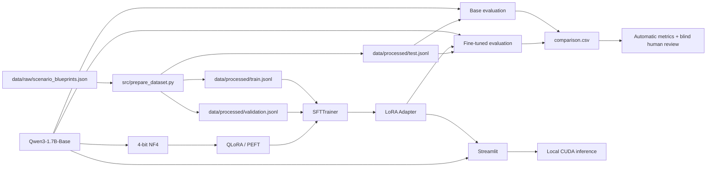

# Arquitetura técnica

## Visão geral

## Componentes

1. **Modelo base**: `Qwen/Qwen3-1.7B-Base`.
2. **Dataset**: 400 cenários sintéticos e versionados em 20 categorias.
3. **Fine-tuning**: SFT com QLoRA.
4. **Quantização**: 4-bit NF4 + double quantization via bitsandbytes.
5. **PEFT**: LoRA aplicado a `all-linear`.
6. **Treino/validação**: `train.jsonl` e `validation.jsonl`.
7. **Teste final**: `test.jsonl`, carregado apenas por `evaluate.py`.
8. **Frontend**: Streamlit carregando base + adapter localmente.
9. **Evidência de GPU**: PyTorch CUDA + `nvidia-smi` + logs de treino.

## Fronteira importante

O projeto não usa OpenAI, Claude, Gemini ou outra API comercial para gerar as respostas do produto. O modelo e o adapter são carregados na máquina local.

## Por que Base e não Instruct?

O objetivo acadêmico é mostrar transformação mensurável a partir de SFT. Um modelo `Base` permite demonstrar com maior clareza o comportamento adquirido pelo dataset especializado. Isso não implica que `Base` será sempre melhor para um produto final; é uma decisão experimental para esta entrega.

## Segurança contra data leakage

`src/train.py` possui caminhos definidos somente para:

- `data/processed/train.jsonl`
- `data/processed/validation.jsonl`

O arquivo `test.jsonl` não é importado pelo código de treino. A avaliação final usa o test set depois que o adapter já existe.
